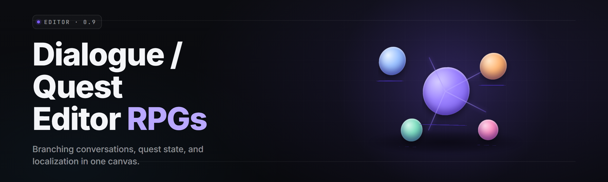

  
  
  

  

  
  
  
  

---

**Author branching dialogue trees, condition-gated quest chains, and localization-ready scripts for RPGs — visually, node by node, without cracking open a single `.json` by hand.**

---

## 📋 Requirements Block

| Component | Minimum | Recommended |
|-----------|---------|-------------|
| OS | Windows 10 build 1909 | Windows 11 23H2+ |
| CPU | Dual-core 2.0 GHz | Quad-core 3.2 GHz |
| RAM | 4 GB | 16 GB |
| GPU | DX11 capable, 1 GB VRAM | DX12, 4 GB VRAM |
| Disk | 400 MB install | 2 GB (project cache + assets) |
| Runtime | .NET Desktop Runtime 8.0 | .NET Desktop Runtime 8.0 |
| Admin | Not required | Recommended for project autosave to protected dirs |

> First launch builds a shader cache for the node canvas — takes ~20s once, then never again.

  

---

## 🗂️ Table of Contents

- [Overview](#-overview)
- [What is RPG Dialogue & Quest Editor](#-what-is-rpg-dialogue--quest-editor)
- [Key Features](#-key-features)
- [The Problem](#-the-problem)
- [The Solution](#-the-solution)
- [Quick Start](#-quick-start)
- [Comparison](#-comparison)
- [Dialogue Graph Modules](#-dialogue-graph-modules)
- [Quest & Condition Modules](#-quest--condition-modules)
- [Data, Localization & Export Modules](#-data-localization--export-modules)
- [System Requirements](#-system-requirements)
- [Installation](#-installation)
- [How To Use](#-how-to-use)
- [Usage Guidelines](#-usage-guidelines)
- [All Modules Status](#-all-modules-status)
- [Known Issues](#-known-issues)
- [Tips for Best Results](#-tips-for-best-results)
- [FAQ](#-faq)

---

## 🔍 Overview

| Category | Details |
|----------|---------|
| Product | RPG Dialogue & Quest Editor |
| Version | v2.6.1 |
| Type | Windows desktop authoring tool (`.exe`) |
| Format target | JSON / YAML / Unreal DataTable / Godot `.tres` / custom engine schemas |
| Primary use | Author branching dialogue + quest graphs, validate, export |
| Distribution | Landing page → download → extract → run |

The RPG Dialogue & Quest Editor is a desktop node-graph authoring environment for writers, designers, and modding teams producing games with heavy narrative trees. It treats every line of dialogue as a node, every branch as an edge, and every quest as a dependency graph the editor can lint, simulate, and export into whatever runtime format your engine expects. Whether you're a solo writer shipping a 12,000-line JRPG or a studio building a live-service quest pipeline, the editor keeps the tree legally navigable instead of a 300-line YAML where one bad tab breaks the whole chapter.

---

## 📖 What is RPG Dialogue & Quest Editor

| Term | Explanation |
|------|-------------|
| **Node** | A single dialogue line, choice prompt, or action (give item, set flag) in the graph |
| **Edge** | A connection between nodes; may carry a condition (only visible if `hasEmberKey == true`) |
| **Flag** | A named boolean/int/string variable tracked across the whole project state |
| **Branch** | A conditional fork in dialogue based on flags, quest state, or speaker stats |
| **Quest Graph** | A DAG of objectives — each objective is a node with completion conditions |
| **Lint** | Static analysis that flags unreachable nodes, orphaned branches, missing localization |
| **Simulator** | Runs the graph with a chosen flag-state seed to preview exact player-visible path |
| **Exporter** | Converts the internal graph into engine-specific runtime format |

Preset benefits:

- Skip YAML indentation hell — dragging node edges beats nanosecond-precision tab-counting.
- Catch dead branches *before* QA does — the linter is merciless and fast.
- Localize from day one — every string is keyed, untranslated strings glow red.
- Simulate every path — seed flags, walk the graph, see the exact line the player sees.
- Round-trip safely — re-import a previously exported file without graph corruption.
- Version-control friendly — .rpgproj is JSON underneath, diffs clean in Git.

---

## ⭐ Key Features

| Feature | Description | Benefit |
|---------|-------------|---------|
| Visual Node Canvas | Pan/zoom graph editor with drag-to-reparent | Author a 500-node tree without losing your sanity |
| Condition Builder | Inline expression editor with autocomplete on flags | Gate branches without memorizing variable names |
| Quest DAG View | Separate layered view for quest objective chains | Track prerequisite ordering visually |
| Linter | 24 rules incl. unreachable, duplicated, missing-locale | Catch structural bugs before export |
| Simulator | Walk the graph with a synthetic player state | Preview the actual player path |
| Localization Table | Grid of string-key × language across the project | Ship 8 locales from one file |
| Batch Rename | Rename a flag everywhere; edges update automatically | Refactor safely mid-project |
| Import Mapping | Map arbitrary engine JSON keys to internal schema | Reuse existing exports without rewrite |
| Diff View | Git-aware side-by-side of two .rpgproj versions | Review branch changes like code |
| Script Hooks | Lua-style expressions for advanced conditions | Handle exotic edge cases without forking the tool |
| Snapshot Notes | Pin a comment to any node for the design team | Institutional memory sticks to the graph |
| Auto-Layout | Sugiyama-style tidy-up for messy graphs | Turn spaghetti back into readable trees |

---

## 🩹 The Problem

- Your dialogue tree is 4,000 lines of YAML and one wrong indent breaks the entire chapter load.
- A branch references a flag set three quests earlier; nobody can remember if that path is even reachable.
- Localization gets bolted on last, so every string needs a late-stage key retrofit.
- QA reports "NPC says the wrong line after the boss fight" and you spend a day grep-hunting the source.
- Designers and writers fight over the same file — one edits lines, the other edits flags, both break each other's work.
- Your quest chain has an invisible prerequisite missing and only playtesters find it, in week five.
- Existing tools are either engine-locked, abandoned, or want a full build pipeline to preview a single line.

---

## 🔧 The Solution

| Problem | Solution |
|---------|----------|
| YAML indentation breakage | Node-graph authoring — no manual indentation anywhere |
| Unreachable / orphaned branches | Linter runs on save and flags dead nodes inline |
| Late localization retrofit | String-key table from day one; new lines get keys automatically |
| "NPC says wrong line" bug | Simulator walks the exact path and prints the visible line |
| Multi-editor conflicts | Split dialogue editing from flag editing; diff view merges safely |
| Missing quest prerequisites | Quest DAG view enforces edge prerequisites visually |
| Engine lock-in | Export to 6+ runtime formats; no build step required to preview |

---

## ⚡ Quick Start

1. **🎯 Open the project page** and hit the download button to grab the current `.exe` bundle.
2. **📦 Extract** the archive to a folder you own (no admin needed unless you want autosave in `Program Files`).
3. **▶️ Run the `.exe`** — first launch unpacks the shader cache, then opens the welcome screen.
4. **🌱 Create a project** or open a sample — the `samples/` folder ships 3 starter graphs (linear, gated, hub).
5. **🔗 Drag your first node**, connect an edge, and watch the linter flag a red dot the moment you orphan something.

---

## 🆚 Comparison

| Aspect | Alternative tools | RPG Dialogue & Quest Editor |
|--------|-------------------|-----------------------------|
| Graph editing | Text editor / spreadsheet | Native node canvas with pan/zoom |
| Linting | Manual or external script | 24 built-in rules, inline feedback |
| Simulation | Full game build required | Run inside the editor, seeded state |
| Localization | Post-process retrofit | Keyed table with per-locale columns |
| Round-trip export | Often lossy | Preserves graph metadata on re-import |
| Quest modeling | Dialogue-only or quest-only | Both in one linked project |
| License | Freemium walls | GPL-3.0, no feature gates |

---

## 🗣️ Dialogue Graph Modules

**Expression & Flow**

| Feature | Effect |
|---------|--------|
| Branch Node | Adds a conditional fork driven by any flag expression |
| Choice Node | Player-prompted list with per-choice visibility conditions |
| Random Line Node | Weighted random pick from a dialogue pool |
| Jump Node | Non-local link to a distant node in the same or linked graph |
| Hub Node | Returns to a calling context — good for shopkeeper loops |
| Wait Node | Inserts a delay or player-input gate before continuing |

**Text & Speaker**

| Feature | Effect |
|---------|--------|
| Line Node | Basic spoken/written line with speaker tag |
| Narrator Node | Overlays italic narration without speaker attribution |
| Portrait Switch | Changes the speaker portrait mid-branch |
| Emote Tag | Attaches an animation tag consumed by your runtime |
| SFX Cue | Fires a named sound event on line entry |

---

## 🧭 Quest & Condition Modules

**Objectives**

| Feature | Effect |
|---------|--------|
| Objective Node | Defines an incremental goal with completion condition |
| Kill / Fetch / Talk Kinds | Preset objective templates for common RPG beats |
| Persist Objective | Marks objective state to survive save/load |
| Reward Node | Attaches item, XP, or gold grant to completion |
| Chained Prereq | Blocks objective until the upstream node completes |

**Conditions & Flags**

| Feature | Effect |
|---------|--------|
| Flag Declaration | Central registry — no phantom flags allowed |
| Number Compare | `gold >= 500` style numeric gates |
| String Match | `playerOrigin == "isles"` gates |
| All / Any / Not | Boolean combinators over arbitrary subconditions |
| Script Hook | Handles exotic conditions via inline script block |
| Sim Seeded State | Injects synthetic flag values during simulation |

---

## 🌍 Data, Localization & Export Modules

**Localization**

| Feature | Effect |
|---------|--------|
| String Key Grid | Editor of key × locale with red-on-untranslated |
| Import CSV | Bulk-load a translation table from external sheet |
| Export CSV | Round-trip translations back out for translators |
| Missing-String Lint | Blocks export if a used key lacks any locale value |
| Placeholder Guard | Catches orphaned `{playerName}`-style tokens |

**Export & Import**

| Feature | Effect |
|---------|--------|
| JSON Export | Neutral schema any engine can consume with one adapter |
| YAML Export | Human-readable for git-friendly repos |
| DataTable Export | Unreal-friendly row struct output |
| Godot `.tres` Export | Resource-format output for Godot projects |
| Custom Schema | User-defined mapping for exotic engines |
| Reverse Import | Reads an exported file back into the graph |
| Diff View | Side-by-side of two project versions, git-style |

---

## 🖥️ System Requirements

| Component | Minimum | Recommended |
|-----------|---------|-------------|
| Windows | 10 (1909+) | 11 23H2+ |
| CPU | 2 cores @ 2.0 GHz | 4 cores @ 3.2 GHz |
| RAM | 4 GB | 16 GB |
| Disk | 400 MB | 2 GB |
| GPU | DX11, 1 GB VRAM | DX12, 4 GB VRAM |
| Runtime | .NET Desktop Runtime 8.0 | .NET Desktop Runtime 8.0 |
| Input | Mouse + keyboard | + pen tablet (canvas work) |

---

## 📥 Installation

1. **Download the bundle.** Open the project page and grab the current `.exe` package. One file, no installer chain.
2. **Extract the archive.** Right-click → Extract All to a folder you control. Everything is portable — no registry writes, no system-path changes.
3. **Launch the `.exe`.** Double-click. If a SmartScreen prompt appears, choose "More info → Run anyway" — the binary is unsigned in the community build. First boot builds the node-canvas shader cache, ~20 seconds.

To upgrade later: replace the folder with a fresh extract; your `.rpgproj` files live wherever you saved them, not inside the tool folder.

---

## ▶️ How To Use

1. **🧱 New project or sample.** `File → New` starts an empty graph. `File → Open Sample` loads a starter — start with `gated-linear` to see branch structure.
2. **🗺️ Lay out dialogue.** Drag nodes from the left palette; click an output port and drag to an input port to connect. Right-click the canvas for quick-insert.
3. **🔐 Gate it with flags.** Declare flags in `Project → Flags`. Drag a flag onto an edge to add an invisible-when-false condition.
4. **🧪 Simulate.** Hit `F5`, seed the flags in the simulation panel, and walk the tree. Every line the simulator prints is the exact string the player would see.
5. **🌐 Key the strings.** `Localization → Auto-Key` assigns a key to every node lacking one. Fill in locale columns; missing ones glow red.
6. **📤 Export.** Pick your runtime from `Export`. The linter runs first and blocks if any node is orphaned or any string is unkeyed.
7. **📚 Save & commit.** `.rpgproj` is JSON underneath — check it into git like any code, diff it in the built-in view when branches collide.

---

## 📜 Usage Guidelines

| Allowed | Not allowed |
|---------|-------------|
| Authoring dialogue trees for your own games and mods | Reverse-engineering copyrighted dialogue from shipped games for redistribution |
| Using the tool for commercial projects you own | Reselling the tool's binaries as your own product |
| Forking, patching, and shipping your fork under GPL-3.0 | Removing the license file from distributed builds |
| Importing and exporting your own project files | Using the export pipeline to launder stolen asset bundles |
| Building localization workflows on the CSV round-trip | Shipping translations you don't have rights to |

This repo is community-maintained, hobbyist-friendly, and aimed at writers and modders who want their trees to survive QA. Use it however the situation calls for, within your engine's own rules about what you're allowed to ship.

---

## 📊 All Modules Status

| Module | Status | Description |
|--------|--------|-------------|
| Line Node | ✅ Working | Base dialogue line with speaker |
| Choice Node | ✅ Working | Player-visible conditional choices |
| Branch Node | ✅ Working | Arbitrary expression-based fork |
| Random Line | ✅ Working | Weighted pool selection |
| Jump Node | ✅ Working | Local and cross-graph jumps |
| Hub Node | ✅ Working | Return-to-caller context loop |
| Wait Node | ✅ Working | Timing / input gates |
| Narrator Node | ✅ Working | Overlay narration without speaker |
| Portrait Switch | ✅ Working | Mid-branch portrait change |
| Emote Tag | ✅ Working | Animation-tag dispatch |
| SFX Cue | ✅ Working | Named-sound event dispatch |
| Objective Node | ✅ Working | Incremental quest goal |
| Kill / Fetch / Talk Kinds | ✅ Working | Preset objective templates |
| Persist Objective | ✅ Working | Save/load-safe objective state |
| Reward Node | ✅ Working | Item / XP / gold grant |
| Chained Prereq | ✅ Working | Upstream objective gating |
| Flag Declaration | ✅ Working | Central flag registry |
| Number Compare | ✅ Working | Numeric comparison gates |
| String Match | ✅ Working | String equality gates |
| All / Any / Not | ✅ Working | Boolean combinators |
| Script Hook | ☑️ Beta | Inline script conditions |
| Sim Seeded State | ✅ Working | Synthetic player-state seed |
| String Key Grid | ✅ Working | Localization editor grid |
| Import / Export CSV | ✅ Working | Translator round-trip |
| Missing-String Lint | ✅ Working | Blocks export on gaps |
| Placeholder Guard | ✅ Working | Token validation |
| JSON / YAML Export | ✅ Working | Neutral + human-readable |
| DataTable / `.tres` Export | ☑️ Beta | Unreal + Godot |
| Custom Schema | 🧪 Experimental | User-defined export map |
| Reverse Import | ✅ Working | Graph reconstruction |
| Diff View | ✅ Working | Git-style project diff |
| Auto-Layout | ✅ Working | Graph tidy-up |

---

## 🧯 Known Issues

| Issue | Fix |
|-------|-----|
| First launch stalls at "building shader cache" | Wait — it completes in ~20s. Do not kill the process; you'll corrupt the cache folder |
| SmartScreen blocks the `.exe` on first run | Choose "More info" → "Run anyway"; community build is unsigned |
| Large graph (>2,000 nodes) feels sluggish on 4 GB RAM | Close other apps or upgrade; canvas is GPU-accelerated but RAM-bound at scale |
| CSV import with non-UTF-8 encoding garbles strings | Re-save the CSV as UTF-8 and re-import |
| Custom schema export drops comments on nodes | Known — comments are tool-native and don't map to third-party schemas |
| Diff view on projects >50 MB locks the UI briefly | Split the project or diff subsets |

---

## 💡 Tips for Best Results

- Declare every flag in the registry *before* referencing it — the linter will still catch you, but you'll avoid a red-dot avalanche.
- Run `Simulate` on every branch before export; walking the path catches 70% of "NPC says wrong line" reports before QA.
- Auto-key strings the moment you add a line — retrofitting 3,000 strings at ship time is a weekend you'll never get back.
- Keep your graph tidy with `Auto-Layout` every 100 nodes; unreachable clusters become obvious when they no longer visually overlap.
- Commit `.rpgproj` files as JSON to git early — diff-view review is where graph mistakes get caught by humans, not linters.
- Use `Reverse Import` after a teammate exports — it reconstructs the graph and shows you what their export actually looked like.

---

## ❓ FAQ

**1. 📅 Is there a release schedule?**
The project ships on a rolling basis — feature builds land as they're ready, and stable tags get cut at milestones. Watch the repo's Releases tab; no fixed dates, no roadmapped promises.

**2. 🛡️ Will Steam / Easy Anti-Cheat flag this?**
The editor is a standalone authoring tool, not an injected runtime. It doesn't hook a game process, doesn't touch game memory, and doesn't modify anything running. Anti-cheat has no reason to see it — you're not running it alongside a game session.

**3. 🎮 Which engines can I export to?**
JSON and YAML ship as first-class exports. Unreal DataTable, Godot `.tres`, and custom schema mappings are in the tool. If your engine eats JSON, you're already supported.

**4. 💼 Can I use it commercially?**
Yes — GPL-3.0 doesn't restrict the output of your work. The tool itself stays GPL; your game's dialogue files are yours.

**5. 🔄 Will I lose work if I re-export and re-import?**
No — round-tripping preserves node metadata, comments, and edge conditions. Custom third-party exports may lose tool-native fields like comments; keep a `.rpgproj` master copy.

**6. 🧩 Does it support non-English locales out of the box?**
The locale table is language-agnostic; any Unicode script loads and displays. Right-to-left rendering is supported but tends to need careful font selection for your runtime.

**7. 🖱️ Is there a plugin or scripting API?**
Script hooks cover in-graph expressions. A full public plugin API is in development — currently reachable only via the tool's script-hook contract.

**8. 🧾 Do I need admin rights?**
No. The tool is portable. Admin is only useful if you want autosave into protected dirs like `Program Files`; otherwise a normal user folder works.

**9. 📦 How big is the download?**
The `.exe` bundle is around 90–110 MB compressed. The extracted folder is ~400 MB after first-run shader cache.

**10. 🚫 Does the tool phone home?**
No telemetry, no analytics, no outbound network calls. It's a local authoring tool — everything stays on disk.

---

## 🔚 The Solution, One More Time

The whole pitch comes down to one thing: RPG dialogue and quest graphs should be authored visually, lint-checked before export, and localized from the first line — not bolted together in YAML and prayed over during week-five playtesting. This editor exists to keep your narrative tree navigable at any scale your project reaches. Open a project, drag one node, connect one edge, hit simulate.

  

